# simPl Reader

**A quiet place for your books.**

A native, offline reader for **PDF, EPUB, HTML, text and Markdown**, built with Rust for Windows x64, with an Android app using the same core.
Keep a local library, pick up where you stopped, and read in a minimal interface
with light and dark themes. Listen with Windows voices, look up words offline,
and keep your highlights and notes with your books.

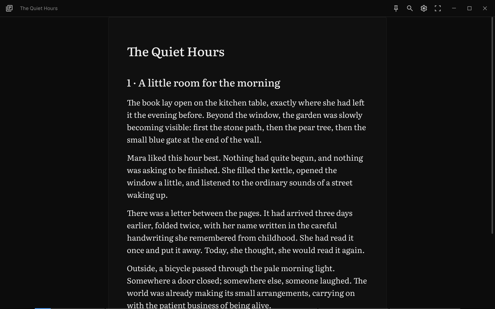

[Get started](#get-started) · [Android](#android) · [Reading modes](#reading-modes) · [Shortcuts](#shortcuts) · [Build from source](#build-from-source) · [Development](#development) · [License](#license)

## Made for reading

- **Your library, on your machine.** Import documents, mark favourites, search by
  title or author, and press Space to resume the book you were reading.
- **Two ways to read PDFs.** Keep the original page in Document view or use Book
  view for reconstructed prose and extracted illustrations.
- **One page at a time.** Visible paper boundaries, a click anywhere along the left
  or right edge to turn the page, and a page field that can jump across the whole book.
- **Stable pages.** Zoom changes the size of the page without changing its number
  or the total. Switching PDF views keeps your current source page.
- **Reading themes.** Pick Default, Soft, Clear or Compact in **Aa** or Settings → Appearance: each sets the
  reading font, line and paragraph spacing, and its own light and dark colors. Page
  numbers and page boundaries stay the same in every theme, and text size stays your
  own. All fonts are bundled, so nothing is downloaded.
- **Reading comfort.** The **Aa** button in the reading bar opens a panel with the theme, text size, font, line spacing, side margins, zoom and **Fit width**. Changes there are remembered for the open book only, and **Use reading defaults** returns it to the defaults. Settings → Reading sets them for every book without its own. Press F11 for fullscreen.
- **Listen and follow along.** Windows' installed voices read continuously across pages and EPUB chapters. The viewport follows the spoken line, and a temporary word highlight shows your place. Pause, resume and adjust the speed; select the stop icon in the bar to stop.
- **Offline word lookup.** Double-click a word or select → right-click → Translate. Choose your language pair and automatic lookup preference. Download only the dictionaries you need; the 13 optional directions cover English, Turkish, Spanish, German, French, Japanese, Korean and Chinese. Lookup works locally after installation.
- **Make the book yours.** Bookmark pages, highlight passages in four colors, and add notes. Revisit them in the sidebar or export them for use elsewhere.
- **Portable reading data.** Create and restore verified library backups, and export bookmarks, quotes and notes as Markdown, text or JSON from Settings → Library & data.
- **Settings in sections.** The gear opens Settings on **Reading**, with its sections listed at the left: **Reading** for the defaults every book follows, **Appearance** for the theme, light or dark and fullscreen, **Listen** for the voice and speed, **Translation** for the languages and dictionaries, **Library & data** for the library folder, backup and export, and **Shortcuts** for the list of keys, which F1 opens from anywhere. Tab reaches the list, and the up and down arrows move between sections.
- **Less chrome.** While you read, one row of quiet icons holds the window and reading
  controls and fades away when idle; point at the top edge to bring it back, or press
  F8 to keep it visible. Every icon names its action and shortcut when you point at it. A
  narrow window hides the book title first, then folds the light and dark toggle,
  Search and Settings into **More**. The page never moves when the bar shows or hides.
  The bar keeps standard Windows minimize, maximize and close buttons. Geist for the interface,
  Literata (or the theme's font) for the book, and bundled fonts for offline reading.
- **Keyboard access.** Navigate controls, switch books, turn pages and copy selected
  text without reaching for the mouse.

## Your workspace

| Light | Dark |
| --- | --- |
| 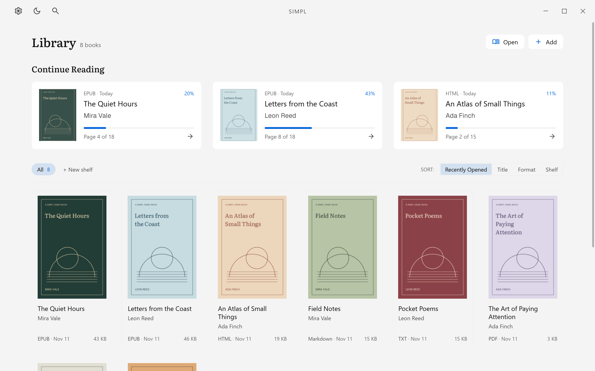 | 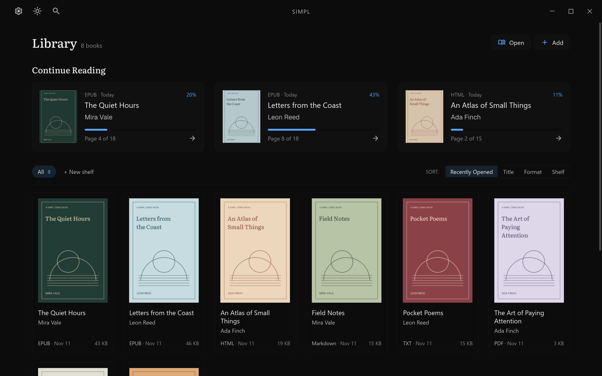 |

Import EPUB, PDF, HTML, TXT and Markdown, search your library and organize shelves.
Once the library holds more than three books, Continue Reading lists up to three
unfinished books. In any library, Space resumes the latest unfinished book. The
original demonstration books shown here are not included with the application.

## Find your reading style

Four reading themes, each with light and dark colors. Typography preferences and
zoom are independent, so you can make the page comfortable while keeping its place.

| Soft · light | Clear · light |
| --- | --- |
| 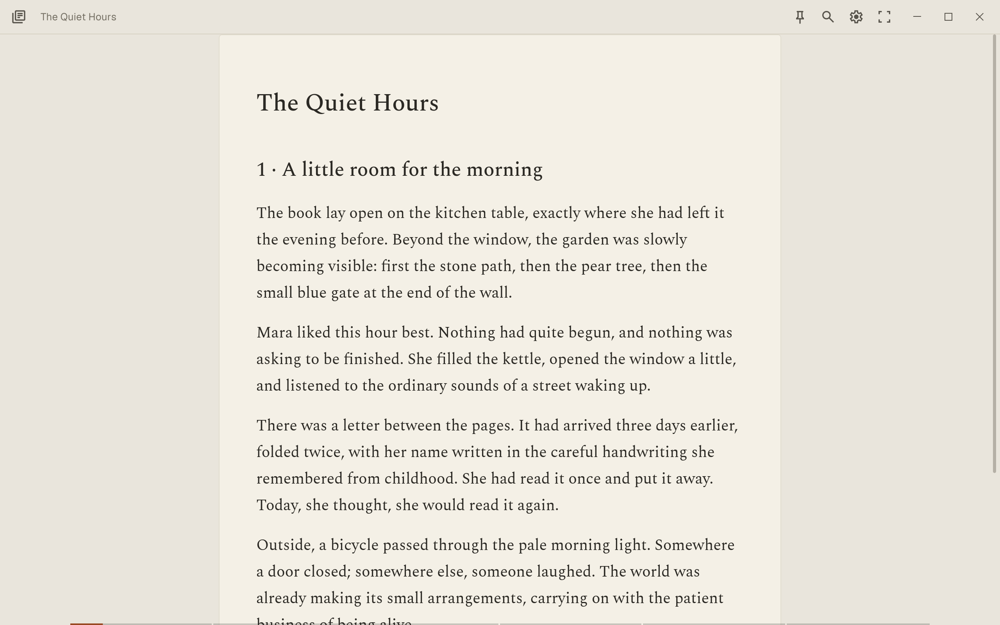 | 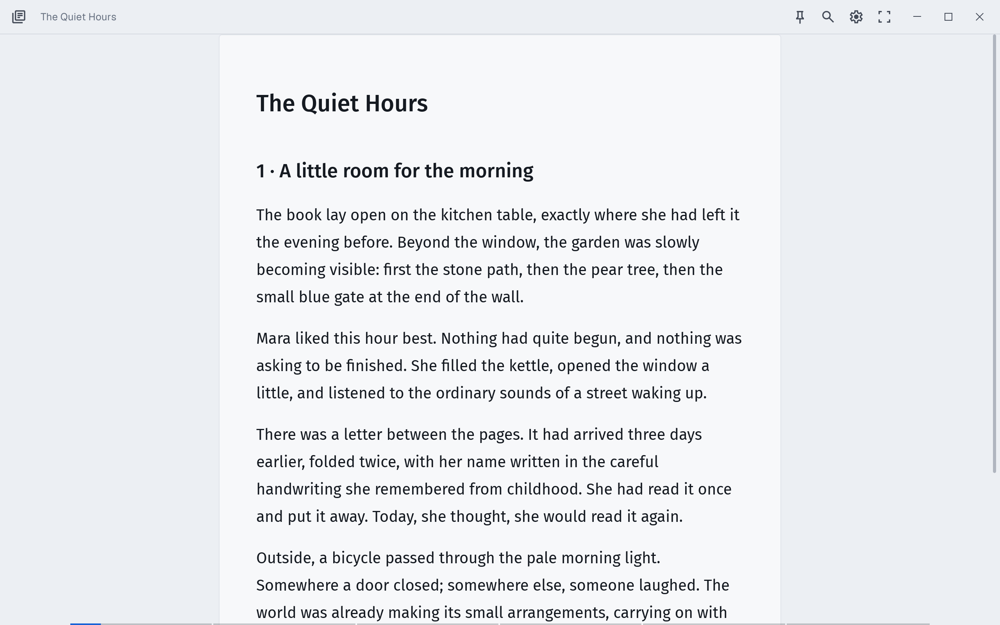 |

| Compact · dark | Fullscreen |
| --- | --- |
| 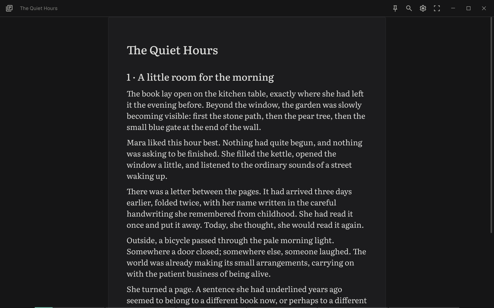 | 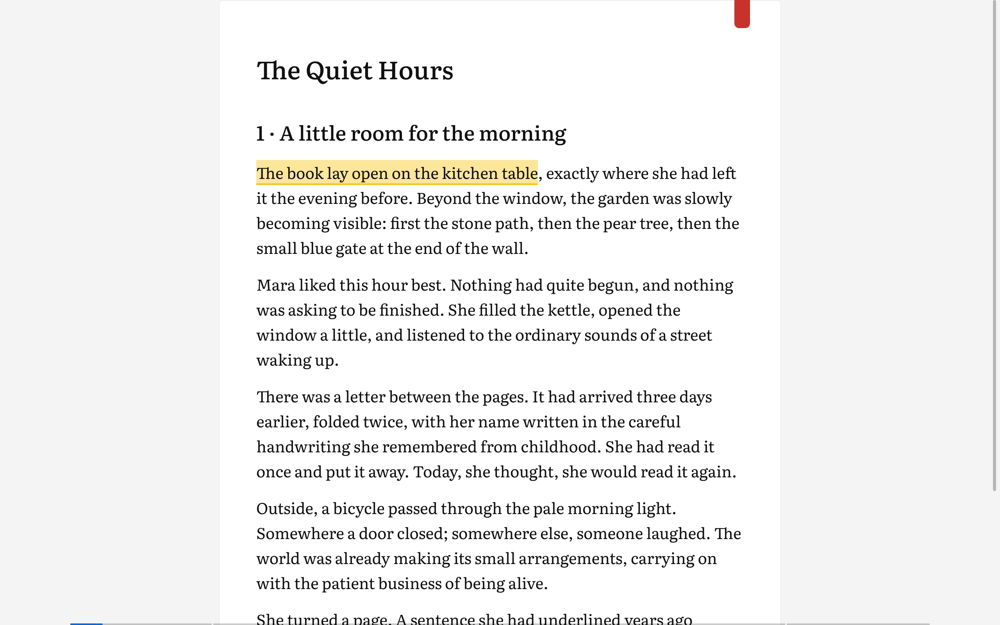 |

## Read, listen, remember

| Highlights and notes | Offline word translation |
| --- | --- |
| 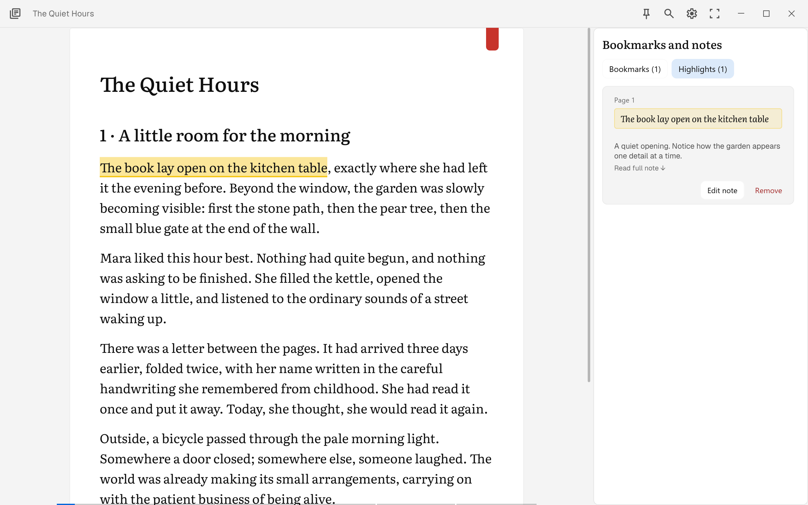 | 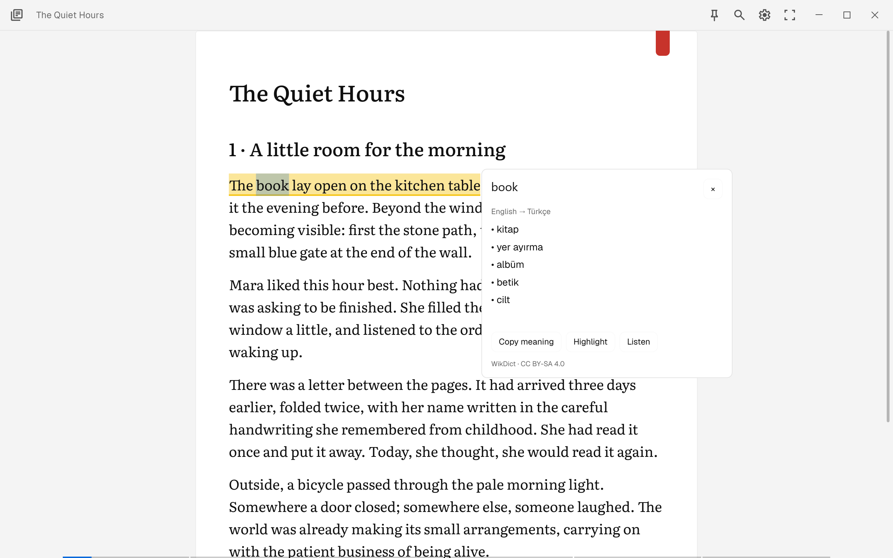 |

Dictionary content in the translation image: [WikDict](https://www.wikdict.com/page/about)
by Karl Bartel, from [Wiktionary contributors](https://www.wiktionary.org/) via
[DBnary](https://kaiko.getalp.org/about-dbnary/), under
[CC BY-SA 4.0](https://creativecommons.org/licenses/by-sa/4.0/).
simPl normalizes and excerpts the data. [Full attribution and website reuse](docs/screenshots/ATTRIBUTION.md).

| Listen with word tracking | Download the dictionaries you need |
| --- | --- |
| 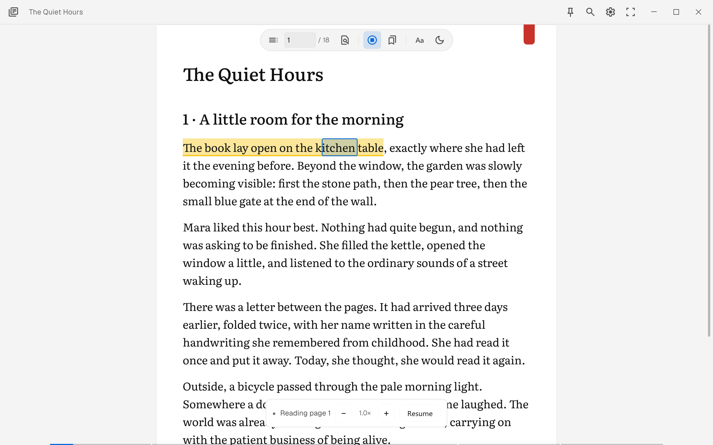 | 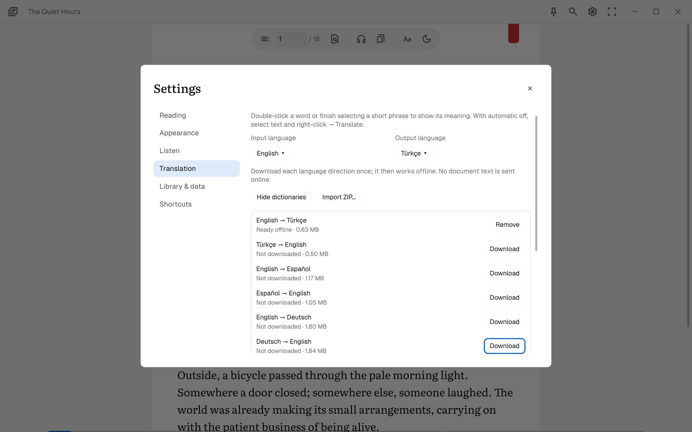 |

| PDF · Document | PDF · Book |
| --- | --- |
| 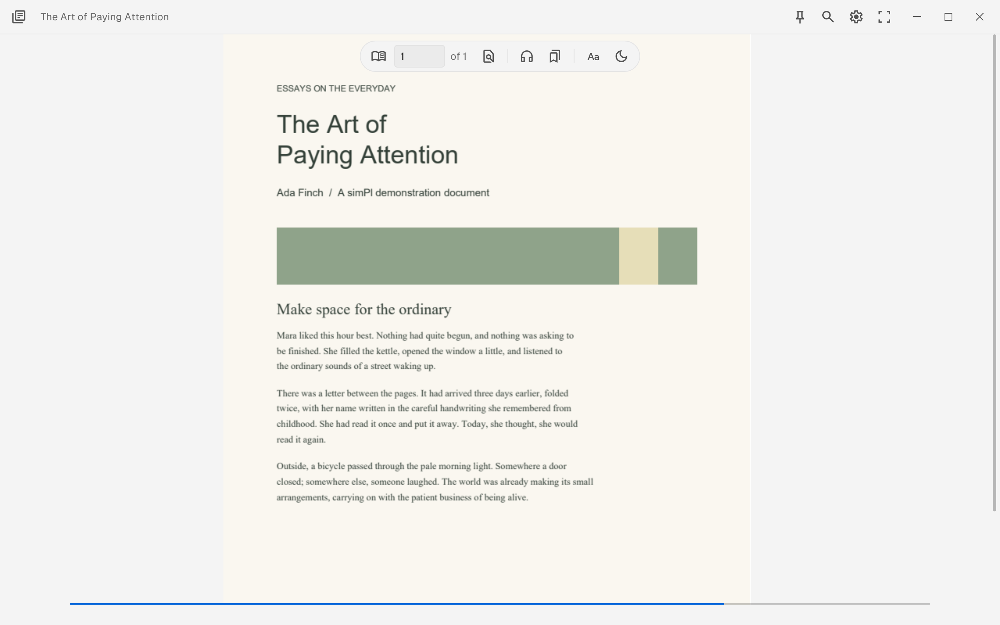 | 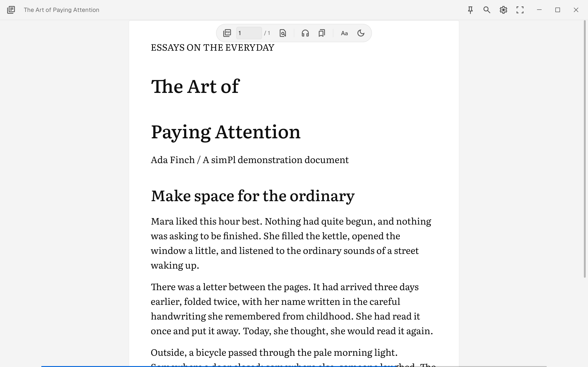 |

| Reading settings | Back up your library |
| --- | --- |
| 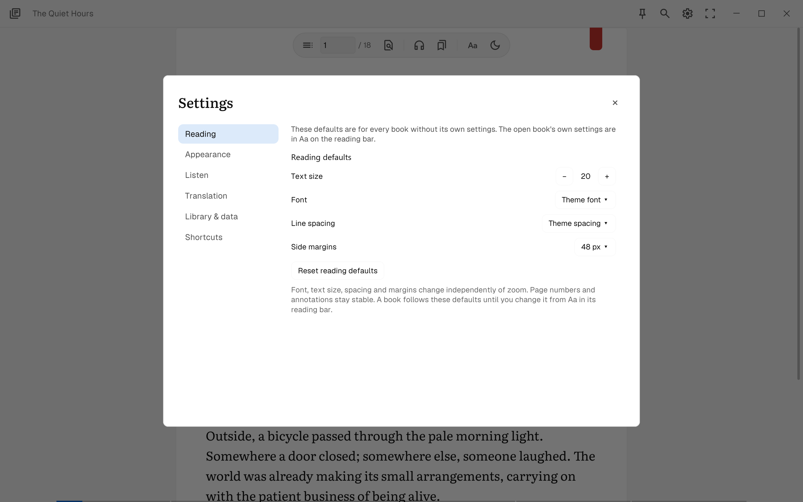 | 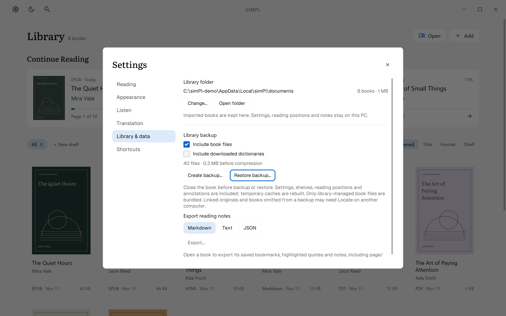 |

[Full-resolution PNGs, lossless WebP copies and media details](docs/screenshots/README.md)
are available for websites and promotion; [download the media kit with updated
attribution](https://github.com/Tikkaaa3/simPl-reader/releases/download/v0.1.5/simPl-0.1.5-promotional-media-attributed.zip).
These are full-window renders of the
production interface at 2560 × 1600, using an isolated demo library; they are
not OS desktop captures. No controls or features were composited into the images.

## Get started

**[Download simPl 0.1.6 for Windows x64](https://github.com/Tikkaaa3/simPl-reader/releases/tag/v0.1.6)**
— installer and portable ZIP. See the [release notes](docs/releases/0.1.6.md)
for changes since 0.1.5.

Desktop releases target **Windows x64**. The setup package is named
`simPl-<version>-windows-x64-setup.exe`. It installs for your Windows account, offers
desktop and Start menu shortcuts, and registers an uninstaller in Windows Settings.
When uninstalling, you can keep your library or delete simPl's imported copies and
reading data. Original files outside the library are left untouched.

To build the setup package, see the [installer guide](installer/README.md).
To create the portable application, follow [Build from source](#build-from-source).
If you already have a portable folder:

1. Run `simPl.exe`. Keep `pdfium.dll` and the `third-party` folder beside it.
2. Select **Open**, press **Ctrl+O**, or drop a supported file into the window to read it where it is.
   Select **Add** or press **Ctrl+I** to copy it into your library.
3. Read, then return to **Library**. Your position and reading preferences are saved.

The portable executable needs no Rust installation. Move or copy the **whole
application folder**, not just the executable. Library data is stored in your
Windows profile rather than beside the executable.

## Android

The Android MVP supports EPUB, PDF, HTML, TXT and Markdown, a private library,
shared desktop page numbers, saved position, bookmarks, highlights and notes.
It requires Android 8.0 or later. APKs are distributed through
[GitHub Releases](https://github.com/Tikkaaa3/simPl-reader/releases), with Android
tags named `android-v<version>` and a SHA-256 file beside each signed download.
Use `simPl-<version>-android-arm64.apk` on most phones; the optional universal
APK also supports x86_64 emulators. Allow installation from your browser or file
manager when prompted, then open the APK. Updates use the same signing key.

Read aloud, dictionaries, backup/export and PDF Book view are planned after the
Android MVP. See the [Android guide](android/README.md),
[0.1.0 notes](docs/releases/android-0.1.0.md) and [roadmap](android-roadmap.md).

## Reading modes

| Format | What to expect |
| --- | --- |
| **PDF · Document** | Original page layout, images and typography, with text selection, zoom and fit-width. Best for academic papers, tables and complex layouts. |
| **PDF · Book** | Reconstructed text in simPl's reading style, with extracted illustrations and the original source-page count. Switching back to Document keeps the current page. |
| **EPUB** | Reflowable EPUB 2/3, contents navigation, internal links and footnotes. Publisher page lists are used when available. |
| **HTML** | Local UTF-8 HTML/XHTML, supported document structure and local images. HTML book folders can also be imported; scripts and remote resources are not executed or fetched. |
| **TXT · Markdown** | `.txt`, `.md` and `.markdown` files are converted to a private HTML page when imported, then read like HTML. Encodings: UTF-8, UTF-16 with a byte-order mark, or the Windows ANSI code page. Markdown supports headings, emphasis, lists, tables, code, footnotes and local images; the library retains the original TXT or Markdown label. |

Older text imports may lack source-format metadata. Add the original TXT/Markdown
file again to repair its library label while reusing the same managed document.

When EPUB or HTML has no source page list, simPl creates a fixed page map on its
first preparation. Zoom from **Aa** or with **Ctrl+plus / minus / 0** scales that map; it does not repaginate it. **Fit width** in **Aa**, or **Ctrl+Shift+F**, fits the page to the window. It follows the window and any drawer docked beside the page, and returns to the previous zoom when toggled off.
Click anywhere along the left or right edge of the reading area, or press the arrow
keys, to turn pages. The edge
shows a soft shade and an arrow while the pointer is over it, and the wheel there still
scrolls the page. The same edges turn pages in PDF Document view.
Keep turning the wheel a little past the end of a Book page to go on to the top of
the next page, or past its top to go back to the bottom of the previous page; a
single notch does not turn it.
A thin line along the bottom shows how far through the book or PDF you are. Point at
it to see the page and percent, or click it to jump to that point.
While you read, the scrollbar hides; it appears when you scroll or point at the right
edge, and fades about a second after you stop.

PDF Book view uses the PDF's existing text layer; it does **not** perform OCR.
Image-only or complex pages may be better read in Document view. Initial preparation
of a large scanned PDF with an existing text layer can take time. Converted content
and illustration regions are cached for subsequent view switches and reopenings.
Blank source pages remain blank.

Select text to choose a highlight color or add a note. Right-click a saved
highlight to change its color, edit its note or remove it. Same-color overlapping
highlights merge without darkening; different colors can overlap. Right-click a
page to bookmark it. The bookmarks and notes sidebar opens from the **Notes** icon
in the reading bar or with Ctrl+B. Click a note in the sidebar to read its full text;
long notes scroll within the list. The **Contents** icon or Ctrl+T opens the book's
contents in a drawer on the left. A drawer sits beside the page while the whole
page still fits beside it; otherwise it opens over the page, and choosing a chapter
then closes the contents drawer. Both drawers stay open together only while the
page fits between them; otherwise opening one closes the other, and zooming in or
narrowing the window closes the contents drawer.
Bookmarks and highlights are stored per book under
`%LOCALAPPDATA%\simPl\annotations\`, so they follow a moved or re-imported file.

Select the **Listen** icon or press **Ctrl+Shift+U** to continue from the current page to the
end of the book, even when text is selected. A small player above the progress line
provides pause, resume, and speed controls without moving the page. It shows and hides
with the reading bar, so it leaves the page's last line clear while you listen; move
the pointer to where it sits, or Tab to it, to bring both back. Starting to listen
shows both for a moment. The viewport
follows the spoken line, turning pages and loading the next EPUB chapter
automatically.
The spoken word has a temporary accent fill and outline in Book and PDF Document views. Pause keeps it visible; stopping clears it. It does not change selection or saved highlights.
Select the same icon, now a stop sign, or press **Ctrl+Shift+U** to stop.
Use **Read aloud** in the selection menu or on a saved highlight to read only
that passage. Choose a voice and speed in Settings → Listen; both are saved. Speech uses
Windows' installed voices
offline. Automatic voice selection estimates the text's language and falls back
to the Windows default. PDF reading needs a permitted text layer; image-only pages
are skipped.

Double-click a word, or finish selecting a short phrase, to open its **offline
translation card**. In Settings → Translation, choose the input/output
languages and turn automatic lookup on or off. With automatic off, use
selection → right-click → **Translate**. The defaults are automatic lookup and
English → Turkish. Escape, an outside click or page navigation closes the card.
Long passages keep the highlight/note menu. PDFs need selectable text and copy
permission; scanned pages need OCR.

The downloadable pairs are English ↔ Turkish, Spanish, German, French, Japanese
and Chinese, plus Korean → English. Chinese → English includes simplified and
traditional forms. Settings → Translation shows each direction’s size and
Download/Remove controls; Manage dictionaries lists all 13. A missing-word card
also offers Download and retries the selected word after installation. Downloads
are explicit, support progress/cancel/retry, and send no document text. Import ZIP
installs the same verified packages without a connection. All packages total
19.77 MB; the executable contains only a 5 KB catalog. Installed files stay in
`%LOCALAPPDATA%\simPl\dictionaries` and work offline; only the current direction
is decompressed. Results are dictionary meanings; coverage varies and basic
English base-form fallbacks are labeled. Full sentence translation and Argos
plugins remain future work. [Data sources and license](assets/dictionaries/README.md).

## Library and local data

**Open** (Ctrl+O), file drops, and double-clicking a file or using **Open with**
read the document where it is. Nothing is copied, and the book appears in **Recent**.
**Add** (Ctrl+I) and **Add to library** on a Recent row copy the document into
the library folder and add it to the library. A dropped HTML book folder is always
copied, because simPl packages it as an EPUB.

The library lists the books simPl keeps a copy of. **Recent** lists everything you
read, including files opened in place.

The library folder is `%LOCALAPPDATA%\simPl\documents\` until you change it in
**Settings → Library & data → Library folder**. **Change…** asks for a folder on this
PC; simPl keeps its books in a `simPl Library` folder inside it and never writes
anything else there. simPl copies every imported book, checks each copy, and only
then switches to the new folder and removes the old copies. **Cancel**, a full disk,
an unplugged drive or a crash before that point leave the library where it was; a
move that was interrupted after it is finished the next time simPl starts. Books you
opened in place are never moved. **Use default folder** moves the library back.
Close the book first; network folders are not supported.

If the library folder is missing, for example on an unplugged USB drive, simPl says
so and never creates an empty one. Connect the drive and choose **Retry**. **Find it…**
accepts the same `simPl Library` under a new drive letter or parent folder, and **Stop
using this folder…** switches back to the default folder without moving or deleting
anything. Uninstalling simPl keeps a library folder outside `%LOCALAPPDATA%\simPl`.

simPl keeps one window. Opening another file from Explorer while simPl is running
opens it in that window and brings it to the front. If that window runs as
administrator or isn't responding, the new launch says so and exits instead of opening
a second window. To open supported files with a double-click, choose **simPl Reader**
in **Open with** and select **Always**.

Reading positions, library metadata, preferences, the library folder setting, cover
thumbnails, bookmarks, highlights, notes and disposable conversion/page caches stay
under `%LOCALAPPDATA%\simPl\`.

Hover a library card to favourite or remove it. Favourites appear in their own
section. Removal asks for confirmation and deletes the application's managed copy;
your original file remains untouched. To keep both the collection and your reading
state, use **Settings → Library & data → Library backup**.

Reading is local and offline. Building the application initially needs network
access to obtain dependencies and the pinned PDF runtime.

## Backup and export

Close the book, then open **Settings → Library & data**. A backup includes settings,
shelves, history, reading positions, per-book typography, covers and annotations.
**Include book files** bundles imported library copies and their local resources;
**Include downloaded dictionaries** optionally bundles installed packs. Temporary
page maps and conversion caches are rebuilt. Linked originals outside the simPl
profile are not bundled, and omitted book files may need **Locate** on another PC.
The displayed size is uncompressed; the saved file is a compressed ZIP.
With a library folder on another drive, that drive must be connected to include book
files; the backup has the same layout as one made with the default folder.

Restore first verifies the archive, shows a review, and requires **Restore and
replace**. It replaces library metadata and settings; directories omitted from
that backup retain their local book files or dictionary packs. Included book paths
and their reading-position keys are remapped to the destination profile. The
previous profile is kept beside the new one in a `.simPl-before-restore-*` recovery
folder. Keep the application closed when manually recovering those folders.
Restore never changes the library folder setting. With a custom library folder, the
backup's books are added to it next to the books already there.
Backup limits are 50,000 files, 512 MiB per file and 16 GiB total.

With a book open, choose **Markdown**, **Text** or **JSON**, then **Export…**.
Exports include bookmarks, highlighted quotes, notes and page/chapter labels;
JSON also preserves their full anchors, IDs and timestamps.

## Shortcuts

| Shortcut | Action |
| --- | --- |
| **Ctrl+O** | Open a file where it is |
| **Ctrl+I** | Add a document to the library |
| **Ctrl+K** | Search and switch books |
| **Ctrl+W** | Save and return to Library |
| **Space** in Library | Resume the most recent unfinished book when no control is focused |
| **← / →** in Book view | Previous / next page |
| **↑ / ↓**, **Page Up / Page Down** | Scroll within the current Book page |
| **Ctrl+L** | Focus the page field |
| **Ctrl+plus / minus / 0** | Zoom in / out / reset |
| **Ctrl+wheel**, touchpad pinch | Zoom in / out |
| **Ctrl+T** in EPUB | Show or hide the contents drawer |
| **Alt+Left** | Return from an internal link |
| **Ctrl+C** | Copy selected text |
| **Ctrl+Shift+U** | Start / stop reading aloud |
| **Ctrl+H** | Highlight selected text with the last used color |
| **Ctrl+D** | Add or remove a bookmark on the current page |
| **Ctrl+B** | Show or hide bookmarks, highlights and notes |
| **Ctrl+Shift+F** | Toggle fit width / previous zoom in Book or PDF Document |
| **F11** | Enter / exit fullscreen; Esc exits after dismissing open panels |
| **F8** | Keep the reading bar visible |
| **Tab / Shift+Tab** | Move between controls |
| **F1** | Open the shortcut list in Settings |

## Build from source

Install **Windows PowerShell 5.1 or later**, **rustup**, and **Visual Studio C++
Build Tools with the Windows SDK**. The repository pins Rust in
[rust-toolchain.toml](rust-toolchain.toml).

From the repository root:

```powershell
# Install the pinned toolchain and developer tools.
rustup toolchain install 1.97.1-x86_64-pc-windows-msvc --profile minimal --component rustfmt,clippy

# Build and launch the reader.
powershell -NoProfile -ExecutionPolicy Bypass -File scripts\dev.ps1 run

# Check formatting, Clippy and workspace tests.
powershell -NoProfile -ExecutionPolicy Bypass -File scripts\dev.ps1 check

# Build a complete portable folder.
powershell -NoProfile -ExecutionPolicy Bypass -File scripts\package.ps1

# Build a website installer (also requires Inno Setup 6.7.3).
powershell -NoProfile -ExecutionPolicy Bypass -File scripts\installer.ps1 -Version 0.1.6
```

The portable output is `target\portable\simPl\simPl.exe`. The scripts initialize
MSVC for their own process, use the lockfile, stage PDFium and collect third-party
notices. Once dependencies and runtime/license caches are populated, add `-Offline`
to the scripts. Close the portable application before replacing its package.

## Development

simPl uses **Iced with the tiny-skia CPU renderer**. The reading interface is native;
it does not embed a browser or WebView.

| Component | Responsibility |
| --- | --- |
| [`iced-shell`](crates/iced-shell) | Library, reader interface, native window and selection |
| [`reader-layout`](crates/reader-layout) | Window-free book layout, canonical pages, reading fonts/themes and adaptation shared with Android |
| [`reader-document`](crates/reader-document) | HTML/EPUB parsing, text and Markdown conversion, managed imports and reading state |
| [`reader-pdf`](crates/reader-pdf) | PDFium worker, PDF text/graphics and Book conversion |
| [`reader-workload`](crates/reader-workload) | Authored diagnostic workloads and assets |
| [`process-measure`](crates/process-measure) | Opt-in process measurements |
| [`reader-profile`](crates/reader-profile) | Profile and cache roots shared by the core crates |
| [`reader-ffi`](crates/reader-ffi), [`uniffi-bindgen`](crates/uniffi-bindgen) | Rust core API and binding generator for the Android app ([android/](android/README.md)) |

See the [developer guide](crates/iced-shell/README.md), [project roadmap](roadmap.md),
[Book parser roadmap](book-parser-roadmap.md), and [design reference](design/DESIGN.md).
The [local reader review](reader-release-review-2026-09-30.md) records current
release checks, performance limits and comparisons with other readers.
For changes, run the workspace check and the focused verification relevant to the
affected reader path. For bug reports, include the format, view mode, page number,
steps to reproduce, and a shareable sample if possible.

Independent clean-Windows package qualification is still pending. The roadmaps
record remaining work; this README describes the implemented reader.

## Third-party notices

Fonts and icons are bundled with their [licenses and source notes](assets/licenses).
The portable package also includes PDFium and Rust dependency notices in
`third-party/`. The repository retains a small [Cosmic Text patch](patches/cosmic-text-0.15.0)
for verified RTL text placement; its rationale is in the developer guide.

## License

simPl is **free to use** and **source-available**. It is not open source.

- **The app.** Official releases from the simPl website or
  [GitHub Releases](https://github.com/Tikkaaa3/simPl-reader/releases) are free for
  everyone, including at work and across an organisation. See the
  [terms for official releases](LICENSE-BINARY.txt).
- **The source code** is licensed under the
  [PolyForm Noncommercial License 1.0.0](LICENSE.md). You may study, modify and share
  it for noncommercial purposes. Commercial use of the source, including builds made
  from it, requires a separate license.
- **The name and logo.** "simPl", "simPl Reader" and the simPl logo are not covered
  by either license. Forks must use a different name and logo.

For a commercial license, contact tikkaaa3@gmail.com. Third-party components keep
their own licenses (see [Third-party notices](#third-party-notices)).
